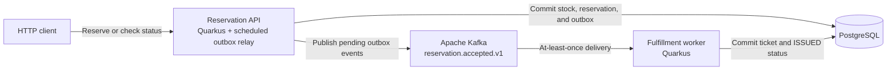

# Failure Lab

[](https://github.com/mosTavassoli/failure-lab/actions/workflows/ci.yml)

**Reproduce failures. Prove recovery.**
The first system under test is a ticket reservation and fulfillment app.
New incidents will share an evidence timeline, runbook links, and recovery
reports—not a separate app for each lesson.

## System architecture



The two Java 21 services share PostgreSQL. The API commits the reservation
and its event together; the worker acknowledges Kafka **after** committing
the ticket. A database constraint prevents a redelivered event from issuing
a second ticket. Docker Compose runs the dependencies for local development;
the incident drill deploys the same workload to kind. See [how Failure Lab
diagnoses the fault and verifies recovery](docs/design.md#incident-evidence-and-recovery).

## Status

The reservation API prevents overselling and commits each accepted
reservation and its outbox event together. A relay publishes pending events
to Kafka; a separate worker issues one ticket per accepted reservation and
acknowledges only after the PostgreSQL transaction commits.

The [first drill](knowledge/worker-redelivery.md) stops a real worker
process between the database commit and Kafka acknowledgement, then
verifies redelivery and compares accepted reservation IDs with issued
tickets. The [Kubernetes/KEDA drill](lab/kind/README.md) is a separate
scenario for CPU scheduling. In the [recorded local run](lab/kind/README.md#verified-local-run),
the HPA requested four workers but only one was ready. After restoring CPU
headroom, lag drained and all 65 accepted reservations reconciled by ticket
ID. Kafka On-Call replayed the captured evidence offline.

Both drills now emit the [same incident report format](lab/reports/README.md).
Read the captured [worker redelivery](lab/reports/recorded/worker-redelivery.report.json)
or [CPU scheduling](lab/reports/recorded/kind-cpu-scheduling.report.json) report
to see the timeline, diagnosis evidence, and ticket-by-ticket verification.
The reports work offline; the browser replay is the next step in the
[`v1.0` roadmap](docs/design.md#v10-scope).

## Run locally

Requirements: **Java 21, Maven, Docker with Linux containers**.
Run the backend integration suite from the repo root:

```sh
mvn verify
```

The tests create disposable PostgreSQL and Kafka containers and do not need
the Docker Compose stack or an API key. The crash test saves
`recovery-it/target/incident-report.json`. The kind evidence tests run without
Docker: `python -B -m unittest discover -s lab/kind -v`. See the
[report checks](lab/reports/README.md#verify-offline) for both replay samples.

To try the app manually:

```sh
docker compose up -d --wait
mvn -f reservation-api/pom.xml quarkus:dev
```

In a second terminal, start the worker **after** the API applies migrations:

```sh
mvn -f fulfillment-worker/pom.xml quarkus:dev
```

Use these requests from a REST client. The development profile seeds a sale
with 12 tickets and binds to `127.0.0.1`:

```http
GET http://127.0.0.1:8080/api/sales/f0000000-0000-4000-8000-000000000001
```

```http
POST http://127.0.0.1:8080/api/reservations
Content-Type: application/json
Idempotency-Key: f0000000-0000-4000-8000-000000000002

{"saleId":"f0000000-0000-4000-8000-000000000001"}
```

The first successful request returns `201` and a `Location` for the
reservation. Sending the same sale and key again returns `200` with the
same reservation ID and current status. Use a new key only for a new
reservation intent. Sales with no available tickets return `409 SOLD_OUT`.
The reservation stays `PENDING` until the worker commits the ticket, then
`GET /api/reservations/{id}` reports `ISSUED`.

Stop both Java processes and run `docker compose down` when finished.

This is a local lab for synthetic data, not a public checkout. There are
no real payments, user accounts, or production integrations.
