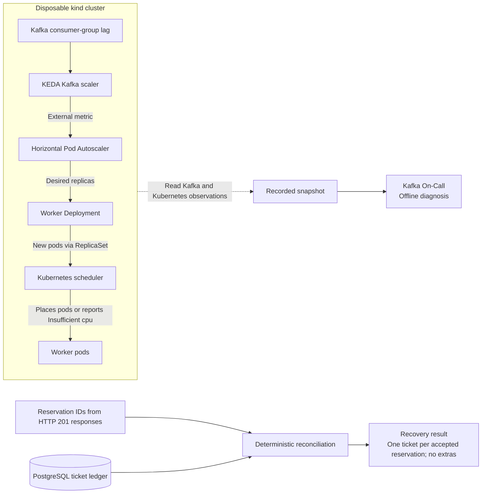

# Failure Lab design and roadmap

## Design goal

Show why a system failed and prove recovery against application state.
For ticketing, a drained Kafka backlog is not proof: every accepted
reservation must have exactly one ticket and there must be no tickets for
unaccepted reservations. The app is a workload for the lab, not a requirement
that every future incident be about ticketing.

| Milestone | Evidence of completion |
| --- | --- |
| **1. Reservation API** | Real PostgreSQL tests show last-ticket contention, idempotent retry, and rollback if the acceptance event cannot be saved. |
| **2. Fulfillment and redelivery** | The [redelivery drill](../knowledge/worker-redelivery.md) launches packaged apps against real Kafka and PostgreSQL. It stops the worker after commit and before acknowledgement, then checks redelivery, the original ticket ID, and reconciliation for both accepted orders. |
| **3. Kubernetes/KEDA incident** | The [kind drill](../lab/kind/README.md) checks a healthy baseline, captures a CPU scheduling block against the same workload, tests recovery by ticket ID, and emits a snapshot for [Kafka On-Call](https://github.com/mosTavassoli/kafka-oncall). |
| **4. Shared report and offline replay (v1.0)** | Both drills emit the same versioned incident report, and a static site replays both incidents from committed reports. See [v1.0 scope](#v10-scope). |

Milestone 4 is the last planned milestone. When it is done, Failure Lab is
complete at `v1.0`. Kafka On-Call, Streamjack, and Infra Agent Conformance
remain independent.

## v1.0 scope

Target: about 20 December 2026. If the date slips, cut scope rather than
extend it.

1. **One incident report format.** The redelivery and KEDA CPU drills write
   the same versioned JSON report with three parts: a sourced timeline, the
   diagnosis evidence, and the deterministic verification result (accepted
   reservation IDs compared with issued tickets: missing, duplicate,
   unexpected). Commit one sanitized report from each drill. A schema test
   validates both, and the negative control with a missing and a duplicated
   ticket must fail verification.
2. **Offline replay.** A static React/TypeScript site reads only the committed
   reports. It lists the incidents and shows each timeline, verification
   result, and matching runbook from [`knowledge/`](../knowledge/). It shows
   what customers saw from recorded data, such as accepted reservation IDs
   and which ones received tickets. No backend, cluster, model, or API key;
   hosted as static pages.
3. **Wrap-up.** A README section on what the lab proves and what it does not,
   a short demo recording, and a `v1.0` tag.

## Out of scope

- An interactive customer screen that calls the live API
- Redis, OpenTelemetry, and Prometheus
- A third incident, such as PostgreSQL lock contention
- Live AI agent or HolmesGPT integration
- Authentication or a hosted backend

## After v1.0

Add something only if all three are true: a specific interview, application,
or research proposal needs it; it takes about a week or less; and it uses the
existing report format. Otherwise record it as an idea and leave it.
Maintenance means keeping CI green and fixing bugs.

## Current transaction boundary

The API uses PostgreSQL at its default `READ COMMITTED` isolation. A
reservation command uses a single transaction:

1. Claim a client-supplied UUID request key with a unique constraint. If a
   committed reservation already owns it, return that reservation for
   the same sale or reject reuse for a different sale.
2. Decrement capacity with one conditional `UPDATE ... WHERE remaining > 0`.
   PostgreSQL rechecks the predicate after a contending transaction
   changes the row. There is no separate availability check followed by an
   unconditional write.
3. Insert an outbox row with an immutable `reservation.accepted.v1` payload
   (`eventId`, `reservationId`, `saleId`, `type`, `occurredAt`). Roll back the
   claim and inventory update on failure.

## Delivery and fulfillment

The scheduled relay claims an unpublished outbox row with
`FOR UPDATE SKIP LOCKED`, publishes with the reservation ID as the Kafka key,
and marks the row published only after broker acknowledgement. It holds a
row lock across the bounded broker request; this is a local-first trade-off
for a simple relay, not a high-throughput design. If the process stops
after broker acknowledgement but before its SQL commit, it can send the
same payload and `eventId` again. Kafka producer idempotence does not make
these two writes atomic.

The worker validates that the event identifies a durable acceptance, inserts
a ticket and marks the reservation issued in the same PostgreSQL transaction,
then acknowledges the Kafka delivery. A unique constraint on `ticket.reservation_id`
makes redelivery a no-op. This gives one durable ticket per reservation
without assuming exactly-once Kafka delivery. The lab uses one database shared
by the API and worker, and it retains outbox rows so the worker can validate
source events. Malformed events fail the consumer rather than being silently
committed; a dead-letter workflow and retention policy are out of scope.

## Incident evidence and recovery

The [system overview](../README.md#system-architecture) shows how a ticket
is issued. The [kind drill](../lab/kind/README.md) runs that same workload
and captures two different kinds of evidence:

**Diagnosis** explains why the requested replicas could not run. KEDA
exposes a metric derived from Kafka lag; it does not place pods. An idle
lab pod's CPU request leaves too little schedulable capacity for new workers.
The snapshot can be replayed offline without a model or a cluster.

**Verification** checks whether the business recovered. After removing
the idle pod and observing lag drain, the drill compares accepted IDs
with the PostgreSQL ledger. Neither a healthy replica count nor an offline
diagnosis is proof that the tickets were issued.

## Knowledge boundaries

Markdown under [`knowledge/`](../knowledge/) is the first source for the
future Knowledge view. Runbooks describe the system and how to interpret
findings. The live or recorded observations establish what happened.
Future AI tools read only bounded, scoped evidence; recovery verification
stays deterministic and outside the model. Keep lab workloads disposable
and use synthetic data only.
